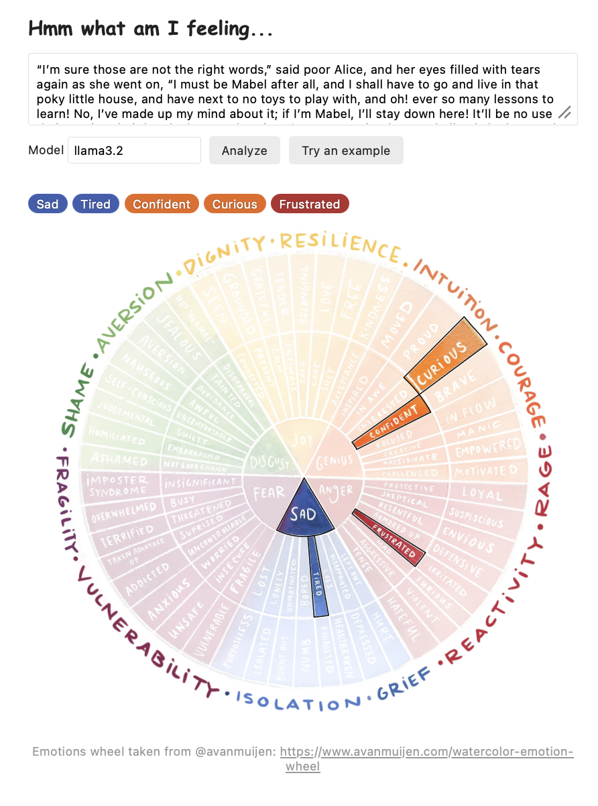

# What I'm feeling

If you don't know what you're feeling, you can ask an LLM for help! Write your stream of consciousness into the textbox and the LLM guesses will
light up on a emotion wheel.

Everything runs on your machine: the text is sent to [Ollama](https://ollama.com) on `localhost`, never to
an outside service.



## Setup

You need Python 3 and Ollama.

1. Install Ollama from https://ollama.com and make sure it's running (`ollama serve`, or open the Ollama app).
2. Pull a model:
   ```
   ollama pull llama3.2
   ```
3. Put the emotion wheel image next to the code as `wheel.png`. See [Emotion wheel](#emotion-wheel) below.

The web page and command-line script use only the Python standard library, so there's nothing to `pip install`.

## Use the web page

```
python3 server.py
```

Open http://localhost:8000, type or paste some text (or click **Try an example**), and click **Analyze**
(or press Cmd/Ctrl+Enter). The model picks 3 to 6 emotion words and the matching spots on the wheel are
outlined, with the rest faded. The chosen words also appear as colored chips above the wheel.

Use the **Model** box to try a different Ollama model, for example `mistral` (run `ollama pull mistral` first).

`server.py` serves the page on `127.0.0.1` only and forwards requests to Ollama at `localhost:11434`.
Use `--port` to change the port.

## Use the command line

```
python3 feelings.py "I can't believe they cancelled again."
python3 feelings.py --file notes.txt
echo "some text" | python3 feelings.py
```

This asks "what are the possible feelings of the speaker?" and streams back a free-text answer.
Add `--model mistral` to use another model.

## How it works

- The page asks the model the question and restricts its answer to the words on the wheel. It does this
  by listing them in the prompt and passing Ollama a JSON schema (`format`) that only allows those words.
- `regions.js` holds one polygon for each of the 102 words, positioned over `wheel.png`. The page draws these
  as an invisible SVG layer, then fades every region except the chosen ones.


## Files

| File | What it is |
| --- | --- |
| `index.html` | The page |
| `server.py` | Serves the page and forwards requests to Ollama |
| `feelings.py` | Command-line version |
| `make_regions.py` | Generates `regions.js` from `wheel.png` |
| `regions.js` | Generated word regions (don't edit by hand) |
| `wheel.png` | The emotion wheel image (from @avanmuijen) |

## Troubleshooting

- **"Could not reach Ollama"**: Ollama isn't running. Start it with `ollama serve`.
- **"Model ... not found"**: run `ollama pull <model>`.
- **Nothing lights up**: the model didn't return any words from the wheel. Try again or use a larger model.
